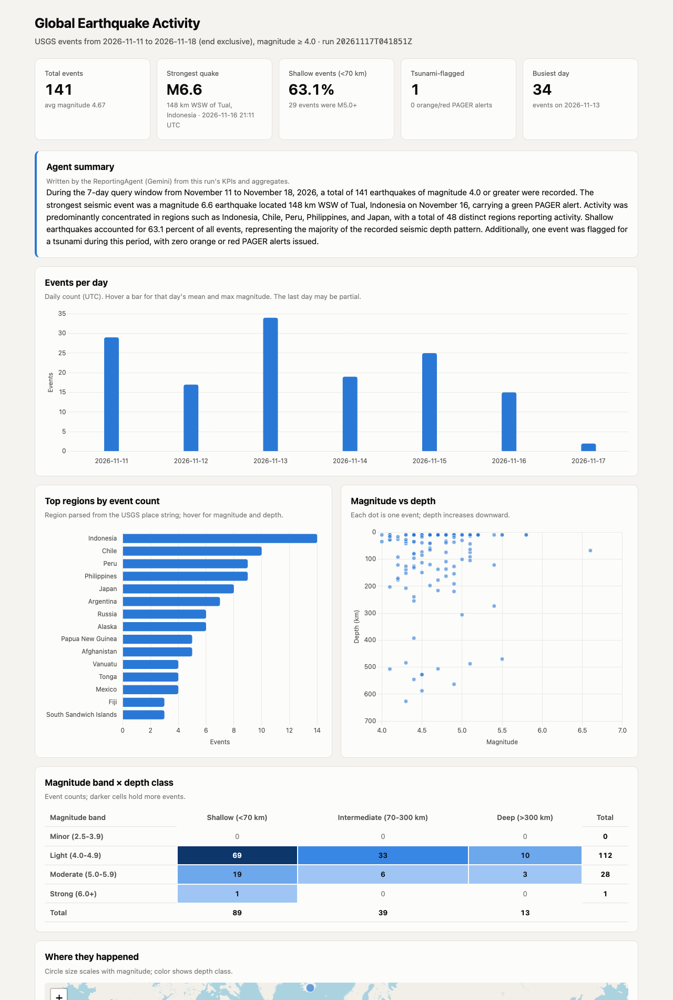

# Agentic Earthquake Data Pipeline (Google ADK)

An end-to-end data engineering pipeline in which **Google ADK agents** ingest
live earthquake data from the USGS API, clean and aggregate it with pandas,
gate on data quality, store raw and processed data in cloud object storage
(GCS, S3, or a local folder), and publish an HTML report with charts and a
summary written by Gemini.

```
python main.py --days 30 --min-magnitude 2.5
```

---

## Architecture

```mermaid
flowchart LR
    U([User request<br/>"last 14 days, M4+"]) --> O

    subgraph O[PipelineOrchestrator · SequentialAgent]
        direction LR
        I[IngestionAgent<br/><i>LlmAgent</i>] --> P[ProcessingAgent<br/><i>LlmAgent</i>]
        P --> S[StorageAgent<br/><i>LlmAgent</i>] --> R[ReportingAgent<br/><i>LlmAgent</i>]
    end

    I -. fetch_earthquake_data .-> API[(USGS GeoJSON API)]
    P -. clean / aggregate / quality .-> W[(Run working dir<br/>output/runs/run_id)]
    S -. upload_raw / upload_processed .-> B[(GCS · S3 · local<br/>raw/ processed/)]
    R -. generate + upload report .-> H[reports/.../index.html]
    H --> B
```

| Agent | Tools | What the agent decides |
|---|---|---|
| **IngestionAgent** | `fetch_earthquake_data`, `halt_pipeline` | Turns a free-text request into query parameters (e.g. "past two weeks, magnitude 5 and up" → `days=14, min_magnitude=5`); halts if USGS returns zero events |
| **ProcessingAgent** | `clean_and_transform`, `compute_aggregations`, `run_quality_checks`, `halt_pipeline` | Reads the quality report and decides to continue (pass), continue with flagged issues (warn), or halt (fail) |
| **StorageAgent** | `upload_raw`, `upload_processed`, `halt_pipeline` | Uploads to the configured backend and reports the URIs; retries/halts on errors |
| **ReportingAgent** | `get_report_data`, `generate_html_report`, `upload_report`, `halt_pipeline` | Writes a 3–5 sentence plain-English summary from a small JSON digest and embeds it in the report |

### Why it is agentic (and why it is still reliable)

- **Agents decide, tools do.** All real work (HTTP, pandas, storage I/O,
  HTML rendering) happens in plain, deterministic, unit-tested Python
  functions. The LLM agents interpret the request, choose tool parameters,
  read every tool's `{"status": "success" | "error", ...}` result, retry
  transient errors, and stop the run when the data should not be published.
- **Why `SequentialAgent` as the orchestrator:** the stage order of an ETL
  pipeline is fixed, so a workflow agent makes the run predictable and easy to
  audit, while each stage is an `LlmAgent` that reasons about its own step.
  An LLM coordinator that "chooses" the next stage would add cost and
  non-determinism without adding value here.
- **No data flows through the LLM.** Tools write files into a run-scoped
  working directory (`output/runs/<run_id>/`). Only small values — paths,
  row counts, `run_id`, KPIs — travel between agents in ADK **session state**
  (`tool_context.state`, `output_key`). The ReportingAgent sees a ~2 KB
  digest, never the 1,900-row dataset.
- **Deterministic guardrails around the LLM** (`before_agent_callback`):
  every run gets a fresh UTC `run_id`; once any stage calls `halt_pipeline`,
  later stages are skipped; and data whose quality check failed is never
  uploaded, even if the model forgot to halt.
- **Resilience:** USGS calls retry 3× with backoff and fall back to the USGS
  summary feed; Gemini calls retry 5× on 429/5xx with a 60 s per-request
  timeout.

> ADK note: this project pins `google-adk==2.14.1`, where `SequentialAgent`
> works but is marked deprecated in favour of the new graph-based `Workflow`.
> The migration is described in [FUTURE_IMPROVEMENTS.md](FUTURE_IMPROVEMENTS.md).

---

## Data source

[USGS Earthquake Catalog API](https://earthquake.usgs.gov/fdsnws/event/1/) (no API key):

```
https://earthquake.usgs.gov/fdsnws/event/1/query?format=geojson&starttime=YYYY-MM-DD&endtime=YYYY-MM-DD&minmagnitude=X
```

Default window: last 30 days, minimum magnitude 2.5 (≈1,900 events). Both are
configurable via CLI flags, `.env`, or a free-text request to the agent.

## Processing logic

1. **Flatten** GeoJSON features to one row per event: id, UTC time, magnitude,
   magnitude type, place, longitude, latitude, depth, significance, tsunami
   flag, felt reports, PAGER alert, status, event type, USGS URL.
2. **Clean** (each step logs rows before/after): drop non-earthquake events
   (quarry blasts, explosions), drop rows with null magnitude or coordinates,
   de-duplicate on `id`.
3. **Derive**: `region` (parsed from the text after the last comma of the
   place string; US state abbreviations → full names, `MX`/`B.C.` → Mexico,
   "Fiji region" → Fiji), `date`, `hour`, `magnitude_band`
   (Minor 2.5–3.9 / Light 4.0–4.9 / Moderate 5.0–5.9 / Strong 6.0+),
   `depth_class` (Shallow <70 km / Intermediate 70–300 / Deep >300; negative
   depths count as shallow).
4. **Aggregate** (each saved separately): daily counts with mean/max magnitude
   (missing days filled with 0); top 15 regions with avg/max magnitude and avg
   depth; magnitude band × depth class grid; top 10 strongest events; KPIs.
5. **Quality checks** → `quality_report.json` with status `pass | warn | fail`:
   zero rows, magnitude outside physical bounds or below the requested
   minimum, invalid coordinates, remaining duplicates, >25% of rows dropped.

## Storage layout

Data-lake style, partitioned by run. The same layout is used for every backend:

```
raw/earthquakes/run_date=YYYY-MM-DD/run_id=<UTC timestamp>/earthquakes.geojson
processed/earthquakes/run_date=YYYY-MM-DD/run_id=<UTC timestamp>/
    events_clean.csv  events_clean.parquet  agg_daily.csv  agg_regions.csv
    agg_band_depth.csv  top_events.csv  kpis.json  quality_report.json
reports/earthquakes/run_date=YYYY-MM-DD/run_id=<UTC timestamp>/index.html
reports/earthquakes/latest/index.html
```

`STORAGE_BACKEND` selects the backend behind one small `StorageBackend`
interface (`upload_bytes`, `upload_file`, `get_public_url_or_uri`):

| Backend | Writes to | Credentials needed |
|---|---|---|
| `local` (default) | `./output/` | none — **use this to run the project without any cloud account** |
| `gcs` | `gs://$GCS_BUCKET/` | Application Default Credentials |
| `s3` | `s3://$S3_BUCKET/` | standard AWS credential chain |

The report is also always written to `output/latest/index.html` so you can open it locally.

## The report



KPI cards, the agent's written summary, events-per-day chart, top regions,
magnitude-vs-depth scatter, magnitude band × depth heatmap, a Leaflet map,
the top 10 strongest events, and a **Data quality & lineage** section (row
counts per cleaning step, quality status, run ID, source URL, storage URIs).
Self-contained HTML; Chart.js and Leaflet load from a CDN.

---

## How to run (instructor quick start)

Requires Python 3.10+ (tested on 3.12) and a free Gemini API key.

```bash
# 1. Clone and enter the project
git clone https://github.com/mahimasreeus/earthquake-adk-pipeline.git
cd earthquake-adk-pipeline

# 2. Create a virtual environment and install pinned dependencies
python3 -m venv .venv
source .venv/bin/activate            # Windows: .venv\Scripts\activate
pip install -r requirements.txt

# 3. Configure
cp .env.example .env
#    then edit .env and set GOOGLE_API_KEY (get one at https://aistudio.google.com/apikey)
#    leave STORAGE_BACKEND=local to run without any cloud credentials

# 4. Run the agentic pipeline
python main.py                                   # last 30 days, M2.5+
python main.py --days 14 --min-magnitude 4
python main.py --prompt "Show me magnitude 5+ quakes from the past week"

# 5. Open the report
open output/latest/index.html                    # Windows: start output\latest\index.html
```

The console shows each agent, every tool call and its status, the agents'
responses, and the list of everything written. Exit code is 0 on success, 1
if the pipeline halted (e.g. zero events or failed quality checks).

### Gemini quota (important)

The default model is **`gemini-3.5-flash-lite`**. On the Gemini **free tier**,
`gemini-3.5-flash` allows only about **20 requests per day**, and one pipeline
run makes about 12 LLM calls (each agent calls the model once per tool step
plus its final answer) — i.e. one run per day. Flash-Lite has a separate and
larger free quota and is plenty for tool-calling and short summaries. With
billing enabled you can set `GEMINI_MODEL=gemini-3.5-flash`.

**Vertex AI instead of an API key:** set `GOOGLE_GENAI_USE_VERTEXAI=TRUE`,
`GOOGLE_CLOUD_PROJECT`, `GOOGLE_CLOUD_LOCATION` in `.env` and run
`gcloud auth application-default login`.

### ADK dev UI and terminal chat

```bash
adk web          # from the project root, then open http://127.0.0.1:8000
                 # pick "earthquake_pipeline" and type e.g. "last 7 days, magnitude 4+"
adk run earthquake_pipeline     # terminal chat with the same agent
```

The dev UI shows the event trace: which agent is acting, each tool call with
its arguments and response, and session state.

### Optional: Google Cloud Storage

```bash
gcloud auth login
gcloud auth application-default login          # credentials the Python client uses
gcloud config set project YOUR_PROJECT_ID
gcloud services enable storage.googleapis.com
gcloud storage buckets create gs://YOUR_BUCKET --location=us-central1 \
    --uniform-bucket-level-access --public-access-prevention

# in .env:  STORAGE_BACKEND=gcs   GCS_BUCKET=YOUR_BUCKET
python main.py --backend gcs
gcloud storage ls -r gs://YOUR_BUCKET/          # or: gsutil ls -r gs://YOUR_BUCKET/
```

**Verified run** (2026-11-17, project `da-makeup-pipeline`, bucket in
`us-central1` with public access prevention enforced): `python main.py
--backend gcs` exited 0 with quality status `pass` (1,925 raw → 1,923 clean
events), and `gsutil ls -r` listed all 11 objects:

```
gs://da-makeup-pipeline-eq/raw/earthquakes/run_date=2026-11-17/run_id=20261117T162829Z/earthquakes.geojson
gs://da-makeup-pipeline-eq/processed/earthquakes/run_date=2026-11-17/run_id=20261117T162829Z/
    agg_band_depth.csv  agg_daily.csv  agg_regions.csv  events_clean.csv  events_clean.parquet
    kpis.json  quality_report.json  top_events.csv
gs://da-makeup-pipeline-eq/reports/earthquakes/run_date=2026-11-17/run_id=20261117T162829Z/index.html
gs://da-makeup-pipeline-eq/reports/earthquakes/latest/index.html
```

Instead of user ADC you can use a service account with only
`roles/storage.objectAdmin` on the bucket and point
`GOOGLE_APPLICATION_CREDENTIALS` at its key file — **stored outside the repo**.

**Viewing the report by URL.** The bucket blocks public access (recommended).
To share the latest report, generate a time-limited signed URL:

```bash
gcloud storage sign-url gs://YOUR_BUCKET/reports/earthquakes/latest/index.html \
    --duration=1h --impersonate-service-account=SA_EMAIL
```

Making the object public (`allUsers:objectViewer`) is simpler but exposes it
to anyone forever and requires disabling public-access prevention; signed URLs
expire and can be scoped to one object, so they are the safer choice.

### Optional: AWS S3

```bash
aws configure                                   # or set AWS_ACCESS_KEY_ID / AWS_SECRET_ACCESS_KEY
aws s3 mb s3://YOUR_BUCKET --region us-east-1
# in .env:  STORAGE_BACKEND=s3   S3_BUCKET=YOUR_BUCKET   AWS_REGION=us-east-1
python main.py --backend s3
aws s3 ls --recursive s3://YOUR_BUCKET/
aws s3 presign s3://YOUR_BUCKET/reports/earthquakes/latest/index.html --expires-in 3600
```

---

## Tests

```bash
pytest -q
```

25 tests run offline against a 13-event fixture
(`tests/fixtures/sample_earthquakes.geojson`) that contains the edge cases the
cleaning must handle: a quarry blast, an explosion, a null magnitude, missing
coordinates, a duplicate id, and a negative depth. They cover region parsing,
cleaning counts, derived fields, every aggregation, KPIs, quality pass/fail,
the tool chain via session state, error reporting, and the local storage
backend and partitioned keys.

## Project structure

```
├── main.py                       # CLI runner: Runner + InMemorySessionService, streams events
├── earthquake_pipeline/          # ADK agent package (adk web / adk run load this)
│   ├── __init__.py               # imports agent so ADK finds root_agent
│   ├── agent.py                  # root_agent (SequentialAgent) + 4 LlmAgents + callbacks
│   ├── config.py                 # .env loading, settings, credential checks
│   ├── templates/report.html.j2  # Jinja2 report template (Chart.js + Leaflet)
│   └── tools/
│       ├── common.py             # run context (run_id, run_dir), result helpers
│       ├── ingestion.py          # USGS fetch with retry/backoff + fallback feed
│       ├── processing.py         # pandas cleaning, derived fields, aggregates, quality
│       ├── storage.py            # StorageBackend: Local, GCS, S3
│       ├── reporting.py          # report digest, HTML rendering, upload
│       └── control.py            # halt_pipeline tool
├── tests/                        # pytest suite + fixture
├── requirements.txt              # pinned, tested versions
├── .env.example                  # every setting, with placeholders
└── FUTURE_IMPROVEMENTS.md
```

## Troubleshooting

| Symptom | Fix |
|---|---|
| `GOOGLE_API_KEY not set — copy .env.example to .env` | Create `.env` from `.env.example` and paste your key. |
| `404 NOT_FOUND ... model ... is no longer available` | Set `GEMINI_MODEL` to a current model, e.g. `gemini-3.5-flash-lite`. List models with `python -c "import earthquake_pipeline.config; from google import genai; print([m.name for m in genai.Client().models.list()])"`. |
| `429 RESOURCE_EXHAUSTED` | Free-tier daily quota used up. Switch to `gemini-3.5-flash-lite`, wait for the daily reset, or enable billing. Per-minute 429s are retried automatically. |
| `503 UNAVAILABLE ... high demand` | Retried automatically (5×). If it persists, re-run in a minute. |
| `USGS API unreachable after 3 attempts` | Network/USGS outage; the summary-feed fallback is tried automatically. Re-run later. |
| GCS `DefaultCredentialsError` / `403` | Run `gcloud auth application-default login`; check `GCS_BUCKET` and that your account has Storage Object Admin on the bucket. |
| `adk web` doesn't list the agent | Run it from the project root (the folder containing `earthquake_pipeline/`). |

## Security and repo hygiene

No credentials are committed. `.env`, service-account JSON files, `.venv/`,
`output/`, and ADK's local session DB (`.adk/`) are in `.gitignore`; the
repo ships only `.env.example` with placeholders. Bucket names, project IDs
and keys come exclusively from environment variables.
